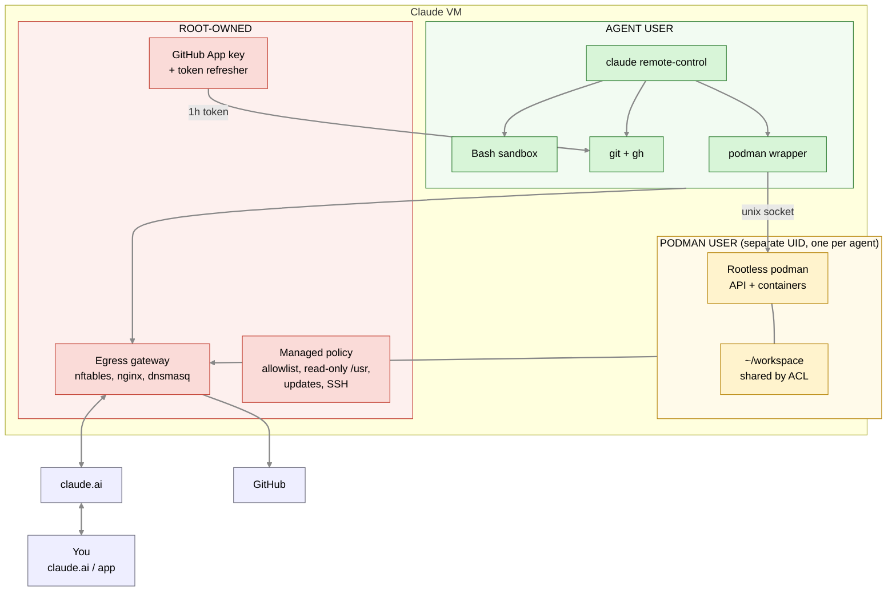
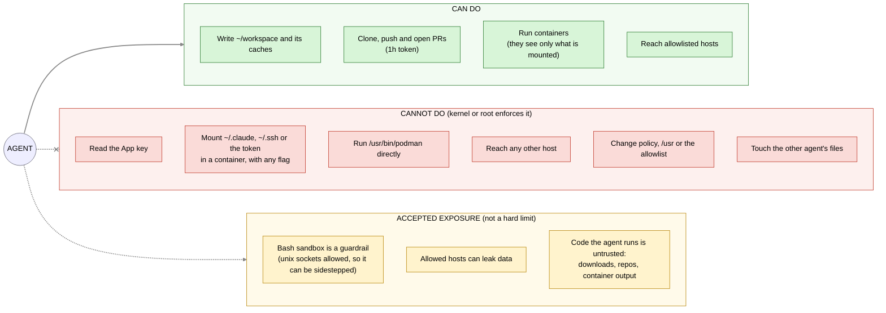
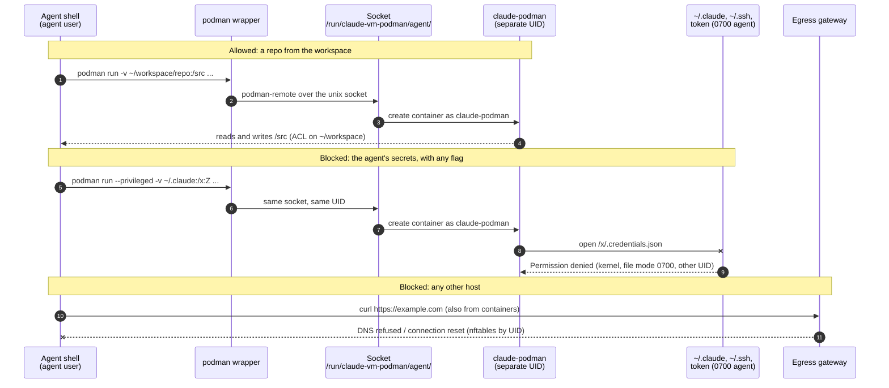

# claude-vm

Back to the [main README](../../README.md).

`claude-vm.containerfile` builds `claude-vm-bootc`: a minimal VM that runs
[`claude remote-control`](https://code.claude.com/docs/en/remote-control) as an unprivileged user, so you can drive it from
claude.ai/code or the Claude app. Layout mirrors the home server: `system_files/claude-vm/`, numbered `/etc/tmpfiles.d/`
files and `tests/claude-vm/`.

## Key files

- [Managed settings](../../system_files/claude-vm/etc/claude-code/managed-settings.json): root-owned policy shipped to `/etc/claude-code/`
- [Egress allowlist](../../build_files/claude-vm/egress-allowlist.txt): the one list of hosts the agent users may reach
- [AGENTS.md](../../system_files/claude-vm/etc/claude-code/AGENTS.md): guidelines and installed tools for the agent

## Overview



The same VM by behaviour: what the agent can and cannot do, and what is accepted exposure:



- **No secrets in the image.** GitHub App keys and Claude logins are seeded by hand on the VM. SSH host keys are generated at first boot.
- **Agent users.** Each runs its own Remote Control service, with its own home, claude.ai login, podman storage, GitHub App and token.
  Nothing is shared between them except the egress gateway.

  | Claude login | Unix user | Service | Session name |
  |---|---|---|---|
  | main | `claude` (1100) | `claude-remote-control` | `<hostname>` |
  | personal (opt-in) | `claude-rc-personal` (1101) | `claude-remote-control-rc-personal` | `<hostname>-rc-personal` |

  Each service has its own memory/CPU caps (percent of VM RAM; see the unit files), so size the VM for the sum
  (2 vCPU / 4 GB light use, 4-8 vCPU / 8-16 GB for parallel builds, 30 GB+ disk for podman). Override with a drop-in in
  `/etc/systemd/system/<service>.d/`.
- **SSH:** key-only for `caspertdk` (sudo), with the same public keys as the home server. The agents have no sudo.
- **Updates:** `bootc-fetch-apply-updates.timer` runs `bootc upgrade --apply` at 03:00, so a new image reboots the VM and ends
  running sessions (Remote Control brings them back for about four hours). Drop `--apply` in
  `bootc-fetch-apply-updates.service.d/override.conf` to only stage.
- **Update button:** `claude-vm-upgrade-poll.timer` (every minute) runs `poll-upgrade claude-vm`, which talks to the "Update VMs" page in the cluster
  (`claude-system/vm-upgrade` in talos-gitops) at `http://vm-upgrade.portableinfo.cloud` (hardcoded; a Cloudflare A record, DNS only, to the
  MetalLB address of `claude-vm-upgrade-lb`). It reports the booted and staged ostree deployment (`rpm-ostree status --json`, local), then, when a
  click is waiting, starts `bootc-fetch-apply-updates.service`, the unit the 03:00 timer runs. The answer is only `{"upgrade": true|false}`, so the
  cluster never sends a command; at most one upgrade per hour. Nothing is seeded: until the DNS record exists the poll only logs that the page is
  unreachable. Access control is the cluster's NetworkPolicy, which lets only the VMs' addresses reach the poll listener. Check with
  `journalctl -u claude-vm-upgrade-poll`. The homeserver image ships the same script (`usr/libexec/vm-upgrade-poll`); keep the two identical.
- **Versions:** Claude Code and Playwright are pinned by `ARG ... # renovate:` lines in the containerfile, crane, hadolint and
  actionlint in `build_files/claude-vm-utilities.sh`. The rest is Fedora packages.

## First-boot setup (once per VM, per agent user)

```sh
ssh caspertdk@<vm>

# 1. Seed that user's GitHub App (see "GitHub access"). The key is read from a file or stdin, never an argument.
sudo claude-vm-seed-github-app claude <app-id> <installation-id> ./app-private-key.pem

# 2. Create the commit-signing key and print its public key (see "Signed commits"; `claude` only)
sudo claude-vm-signing-key

# 3. Sign in as the agent user. Remote Control needs a claude.ai login (API keys are not supported).
sudo -iu claude
cd ~/workspace && claude          # /login, trust the folder, then exit
claude remote-control             # answer 'y' to "Enable Remote Control?", then Ctrl-C
exit

# 4. Start the service (enabled, but idle until steps 1 and 3 are done)
sudo systemctl restart claude-remote-control
journalctl -u claude-remote-control -f     # shows the session URL
```

For `claude-rc-personal`, repeat steps 1 and 3 with that user, then `sudo systemctl enable --now claude-remote-control-rc-personal`.
It stays inert until `~/.claude/.credentials.json` exists. Its `~/.gitconfig` turns commit signing off; set your own
`user.name`/`user.email` (and a signing key) there.

Rotate an App key by re-running step 1. Claude logins live in `~/.claude/` and survive upgrades.

## GitHub access

Each agent user acts as its own GitHub App (a bot), not as a person with a personal token, so repositories and permissions
can differ per user. An App's private key lives only in `/etc/claude-vm/github-app/<user>/` (root, 0600). The template
units `claude-vm-github-token@<user>.timer` and `.service` run `refresh-github-token <user>` as root every 30 minutes (and at
boot): it signs a JWT, trades it for a one-hour installation token and writes it to `/run/claude-vm/<user>/github-token`
(0640 root:`<user>`, tmpfs). Nothing holds the token in an environment variable: the `gh` wrapper in
`/usr/libexec/claude-vm/bin` (first on the service's `PATH`, and the git credential helper in `/etc/gitconfig`) reads the
calling user's token file on every call. A user cannot read another user's token or any private key.

Create an App per user:

1. GitHub > Settings > Developer settings > GitHub Apps > New. Repository permissions: **Contents** and **Pull requests**
   read/write, **Metadata** read; add **Actions** read to read workflow runs. Leave the rest off (without **Workflows** it
   cannot change `.github/workflows/`). Untick "Webhook active". Never make it a bypass actor in a ruleset.
2. Generate a private key, install the App only on the repositories that user should touch, and note the **App ID** and
   the **installation ID** (the number at the end of `https://github.com/settings/installations/<id>`).
3. `sudo claude-vm-seed-github-app <user> <app-id> <installation-id> ./key.pem`, then delete the `.pem`.

The token carries the App's permissions on every repository it is installed on, so narrow them in the App's settings.
Check with `journalctl -u claude-vm-github-token@<user>` and `sudo -u <user> gh api /installation/repositories`.

## Signed commits

`/etc/gitconfig` signs every commit and tag of `claude` with an SSH key made on the VM by `sudo claude-vm-signing-key`
(`--rotate` replaces it). The key is `/var/home/claude/.ssh/claude_signing`, has no passphrase, and until it exists commits
fail rather than going out unsigned. GitHub shows "Verified" only if the commit email is verified on the account holding the key.

1. Add the key printed by `claude-vm-signing-key` to your GitHub account as a **Signing Key** (Settings > SSH and GPG keys).
2. Set a commit email verified on your account (your `<id>+<username>@users.noreply.github.com` address works). `claude`
   cannot edit `~/.gitconfig`, so as `caspertdk`, from a directory `claude` can read:

   ```sh
   cd /var/home/claude && sudo -u claude git config --file /var/home/claude/.gitconfig user.email "<your-verified-email>"
   sudo claude-vm-signing-key    # refreshes ~/.ssh/allowed_signers
   ```

Commits are attributed to you and the key signs as you, so if it leaks, delete it on GitHub and run `--rotate`.

## SSH over a free Pinggy tunnel (opt-in)

`claude-pinggy.service` opens an account-less [Pinggy](https://pinggy.io/docs/run_tunnel_on_startup/linux/) TCP tunnel to
sshd, so you can log in without knowing the VM's IP. It ships disabled: `sudo systemctl enable --now claude-pinggy`.

```sh
claude-vm-ssh-address        # on the VM; or ask Claude, or type /ssh-address
ssh -p 41234 caspertdk@abcde-1-2-3-4.a.free.pinggy.link
```

The address changes whenever the tunnel restarts (free tunnels last about 60 minutes). The sshd is then on the internet:
password login is off and only the keys in `authorized_keys.pub` work, but disable it when unused
(`sudo systemctl disable --now claude-pinggy`).

## Haiku subagents

`/usr/share/claude-vm/agents/*.md` are user-level Claude Code subagents, all on Haiku, symlinked into `~/.claude/agents/`
of both agent accounts by tmpfiles.d (so they follow the image on upgrade). None has edit tools.

| Agent | Use |
|---|---|
| `cluster-ops` | Thin relay: the VM has no route to the Talos cluster, so it sends a read-only question to a new session in the `claude-k8s-helper` Remote Control environment (`create_session`) and reports the answer |
| `ci-triage` | Read-only triage of a failing Actions run or PR check with `gh`: first real error, kind of failure, likely fix |
| `lint-runner` | Runs `yamllint`, `shellcheck`, `shfmt`, `actionlint`, `hadolint` and the repo's validation script on the changed files and returns only the failures |
| `researcher` | Read, Grep, Glob, WebSearch and WebFetch only: looks up upstream docs and current facts and reports sources with versions |

Only `cluster-ops` has cluster-specific details; the others are repo-agnostic.

`cluster-ops` shares its name with the full `cluster-ops` agent in the talos-gitops repo (`.claude/agents/`). Project agents beat
user agents of the same name, so inside a talos-gitops worktree the full agent (repo edits, validation, PRs) loads, and
everywhere else this relay does.

## Security model

- **Policy:** `/etc/claude-code/managed-settings.json` has the highest precedence and `claude` cannot change it. Sessions start
  in bypass-permissions mode; the sandbox, deny rules and egress gateway are the limits. Only managed hooks run
  (`allowManagedHooksOnly`), so hooks in cloned repositories are ignored. Keys and values are documented by
  [managed settings](https://code.claude.com/docs/en/managed-settings.md); changes to this file are in git.
- **Bash sandbox:** required (`bubblewrap`). It limits writes to the paths in the diagram above, reaches only allowlisted hosts and
  cannot read `~/.claude/.credentials.json`. `podman` and `podman-compose` are excluded because rootless podman cannot run inside
  it; they run containers as a separate UID (see below) and the podman socket is reachable from the sandbox (unix sockets are allowed, see below). It is a guardrail,
  not a hard boundary: the proxy filters by hostname, so broad hosts such as `github.com` can carry data out, and MCP servers and
  hooks are not covered.
  `allowAllUnixSockets` is on so podman and chromium work in any command shape (path-based `allowUnixSockets` is macOS only). The
  cost: a sandboxed command can reach the agent's own systemd/D-Bus socket and start a process outside the sandbox. UIDs do not
  help there (same user); only the egress gateway (nftables by UID) still applies.
- **A Remote Control session is a shell as the agent user.** Whoever controls your claude.ai session controls the VM. Turn on
  [Require trusted devices](https://code.claude.com/docs/en/remote-control.md#trusted-devices).
- **GitHub Apps:** install each only on the repositories its user should touch (see "GitHub access").
- **Data and terms:** the session transcript is stored on Anthropic's servers while connected. Use your own login and do
  not share it. Do not set `CLAUDE_CODE_DISABLE_NONESSENTIAL_TRAFFIC`: it also disables Remote Control.

## Usage telemetry

Claude Code sends OpenTelemetry metrics to the OTLP receiver of the cluster's Prometheus, tagged `environment=claude-vm`. Both agent
users send. The settings are the `OTEL_*` entries of [managed-settings.json](../../system_files/claude-vm/etc/claude-code/managed-settings.json)
and are the same as `claude-rc`'s in the cluster, except for the endpoint (the pod uses the in-cluster service) and the environment name. What each variable does, the metric names, the
labels and the retention are described once, in
[talos-gitops `k8s/apps/claude-system`](https://github.com/cthtrifork/talos-gitops/tree/main/k8s/apps/claude-system#usage-telemetry);
change both places together.

- **Endpoint:** `http://otel.portableinfo.cloud/api/v1/otlp`, port 80: a Cloudflare A record to a private LAN address of the cluster.
- **DNS:** the name must resolve to the private address through the VM's resolver. If that resolver filters private answers for public
  names (DNS rebinding protection), exports fail with a DNS error in the Claude Code log.
- **Auth:** none; the endpoint is LAN-only and the cluster's network policy limits who can reach it.

## Containers run as a separate UID

`podman` for the agent users is a wrapper that talks to the API of another user, `claude-podman` (1200) or
`claude-rc-personal-podman` (1201), run by `claude-vm-podman@<agent>.service`. Containers therefore run as that UID, which the
kernel keeps out of the agent's home: `~/.claude`, `~/.ssh` and the token stay `0700`, so no mount flag can expose them. Podman
is outside the Bash sandbox, so a podman running as the agent could mount anything the agent can read.

What that looks like for a mount that is allowed, one that is not, and an outbound request:



- The agent users have no subuid range and cannot execute `/usr/bin/podman` (0750, group `claude-podman-exec`).
- The socket (`/run/claude-vm-podman/<agent>/`, 0660, agent's group) is reachable only by its own agent.
- `podman-prepare` gives `<agent>-podman` an ACL on `~/workspace` only (default ACL, so what containers write stays writable for
  the agent) and traverse-only on the home.
- The podman UIDs are in the egress gateway's UID set. SELinux label separation is off for these containers (`label = false`):
  file permissions are the boundary.
- Files created with an explicit restrictive mode (`install -d -m 0755`, `cp -p`) shrink the ACL mask and leave `<agent>-podman`
  read-only there; `chmod g+w` fixes a path.
- Residual risk: containers can read and write whatever they mount from `~/workspace`, and a container escape lands as
  `<agent>-podman`. Files they plant are as untrusted as any download, so mount the narrowest folder (read-only if possible) and
  use trusted images.

## Egress gateway

Everything the agent users start, including rootless podman containers, reaches only hosts on one allowlist, enforced in the
kernel by UID (`claude`, `claude-rc-personal` and the podman subuid ranges), independent of the sandbox.

| Unit | What it does |
| --- | --- |
| `claude-vm-egress-nft` | nftables: redirects DNS to dnsmasq and HTTPS/HTTP to nginx, rejects everything else (QUIC, SSH, other ports, IPv6) |
| `claude-vm-egress-proxy` | nginx, no TLS interception: reads the SNI (or HTTP `Host`) and drops unlisted names and IP literals |
| `claude-vm-egress-dns` | dnsmasq: resolves only allowlisted domains |

Root, `caspertdk`, `bootc upgrade`, dnf and the Pinggy tunnel are not restricted. The remote-control services require all three
units. SELinux is enforcing, which is why nginx runs from a copy under `/usr/libexec/claude-vm/`, and systemd-resolved's
varlink socket is root-only so `nss-resolve` cannot bypass the DNS filter.

**One allowlist.** `build_files/claude-vm/egress-allowlist.txt` has one domain per line (subdomains included).
`egress_allowlist.py` fails the image build on an invalid, duplicate or redundant entry and derives the sandbox's
`allowedDomains` and the nginx and dnsmasq maps from it. To allow another host, add it and rebuild.

**What a block looks like.** Usually "could not resolve host"; a listed name blocked at the proxy shows as a connection reset
(HTTPS) or a 403 (HTTP). SSH and git-over-SSH are blocked; use HTTPS remotes. `sudo claude-vm-egress blocked` summarises
blocked requests since boot (`--raw` plus any `journalctl` argument for each one), `claude-vm-egress allowed` prints the list.

## Operating notes

- systemd restarts the services (`Restart=always`); an unreachable VM shows as an offline session at claude.ai/code. For push
  notifications, run `/config` once in an interactive `claude` as the agent user.
- `/var` and `/etc` are not re-applied on upgrade (tmpfiles `C` never overwrites). Revoking a key in a later image does not
  reach VMs that already booted: edit `~caspertdk/.ssh/authorized_keys` there. Keep local policy changes in
  `/etc/claude-code/managed-settings.d/*.json`; list drift with `ostree admin config-diff`.
- Give parallel agents separate git worktrees. Containers share the `claude-vm-podman@<agent>.service` limits (60% / 80% of RAM);
  cap a single one with `podman run --memory/--cpus`.

## Build a disk image

`create-vmdk-image.yaml` accepts `claude-vm-bootc`; CI builds it with the other images. Locally:

```sh
sudo podman run --rm -it --privileged -v ./out:/output -v ./config.toml:/config.toml:ro \
  quay.io/centos-bootc/bootc-image-builder:latest --type qcow2 --config /config.toml \
  ghcr.io/cthtrifork/homeserver-bootc/claude-vm-bootc:latest
```

## Tests

`tests/claude-vm/` runs in QEMU when a non-draft pull request has the `e2e` label: tools, idle services, policy, users, home
and token directory permissions, no baked-in keys, the seed helper, rootless podman (secret mounts with every flag blocked, workspace
read/write, socket permissions), and the egress gateway (also from inside podman containers). Not covered, because it needs a logged-in Claude: sign-in, the Remote Control session, and the sandbox
and `SessionStart` hook in a live session.
