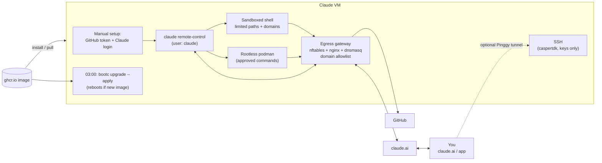

# claude-vm

Back to the [main README](../../README.md).

`claude-vm.containerfile` builds `claude-vm-bootc`: a minimal VM that runs
[`claude remote-control`](https://code.claude.com/docs/en/remote-control) as the unprivileged user `claude`, so you can
drive it from claude.ai/code or the Claude app. Layout mirrors the home server: `system_files/claude-vm/`, numbered
`/etc/tmpfiles.d/` files and `tests/claude-vm/`.

## Key files

- [Claude config (managed settings)](../../system_files/claude-vm/etc/claude-code/managed-settings.json): policy shipped to `/etc/claude-code/`
- [Egress allowlist](../../build_files/claude-vm/egress-allowlist.txt): the one list of hosts the VM may reach
- [AGENTS.md](../../system_files/claude-vm/etc/claude-code/AGENTS.md): guidelines for the agent, included by the managed [CLAUDE.md](../../system_files/claude-vm/etc/claude-code/CLAUDE.md)

## Overview



## What is in it

- **No secrets.** The build takes none: no registry, age or SSH keys. You seed a GitHub App's credentials by hand and sign in to
  Claude interactively (first-boot steps below). SSH host keys are generated on the VM at first boot.
- **SSH uses the same public keys as the home server.** `authorized_keys.pub` is copied from
  `system_files/homeserver/` at build time and installed for `caspertdk` by `11-caspertdk-ssh.conf`. Login is key-only.
  `caspertdk` has sudo; `claude` has none. The image holds no private key, so commit signing uses a separate key generated on the VM (below).
- **Tools for Claude:** bash, python3/pip, node/npm, go, skopeo, crane, git/gh, make, jq, yq, shellcheck, shfmt, yamllint, hadolint, actionlint, rootless podman with podman-compose (the provider behind `podman compose`) and Playwright (library under `/usr`, browser is Fedora's `chromium`; launch with `executablePath: process.env.PLAYWRIGHT_CHROMIUM_EXECUTABLE_PATH` and `--no-sandbox`, no browser download needed). `/usr` is
  read-only, so `npm -g`, `pip --user` and `go install` use the home directory.
- **Egress allowlist:** everything the `claude` user runs, rootless podman containers included, can only reach the hosts in
  `build_files/claude-vm/egress-allowlist.txt`; see [Egress gateway](#egress-gateway).
- **Versions:** Claude Code is pinned by an `ARG ... # renovate:` line in the containerfile; Playwright by an `ARG ... # renovate:` line too; crane, hadolint and actionlint by
  `# renovate:` lines in `build_files/claude-vm-utilities.sh` (downloaded checksum-verified, cached in the CI runner cache). Everything else is a Fedora package that moves with the `fedora-bootc` base image.
- **Updates:** `bootc-fetch-apply-updates.timer` runs every night at 03:00 and runs `bootc upgrade --apply`, so a
  newly pulled image is applied by an automatic reboot. That ends a running session; Remote Control restarts with the
  service and brings its sessions back for about four hours. To only stage updates, drop `--apply` from
  `bootc-fetch-apply-updates.service.d/override.conf`. If an update is staged but no reboot happened, a marker in `/run`
  and the managed `SessionStart` hook still tell Claude, and so you.

## First-boot setup (once per VM)

```sh
ssh caspertdk@<vm>

# 1. Seed the GitHub App credentials (see "GitHub access" below). The key is read from a file or stdin, never an argument.
sudo claude-vm-seed-github-app <app-id> <installation-id> ./app-private-key.pem

# 1b. Create the commit-signing key and print its public key (see "Signed commits" below)
sudo claude-vm-signing-key

# 2. Sign in as the service user. Remote Control needs a claude.ai login (API keys are not supported).
sudo -iu claude
cd ~/workspace && claude          # /login, trust the folder, then exit
claude remote-control             # answer 'y' to "Enable Remote Control?", then Ctrl-C
exit

# 3. Start the service (enabled, but idle until steps 1 and 2 are done)
sudo systemctl restart claude-remote-control
journalctl -u claude-remote-control -f     # shows the session URL
```

Rotate the App's private key by re-running step 1. The Claude login lives in `/var/home/claude/.claude/` and survives upgrades.

## GitHub access

The VM acts as a GitHub App (a bot), not as a person with a personal token. The App's private key lives only in
`/etc/claude-vm/github-app/` (root, 0600), which `claude` cannot read. `claude-vm-github-token.timer` runs
`refresh-github-token` as root every 30 minutes (and at boot): it signs a JWT, trades it for a one-hour installation
token and writes it to `/run/claude-vm/github-token` (0640 root:claude, tmpfs). Because the token expires, nothing holds
it in an environment variable: the `gh` wrapper in `/usr/libexec/claude-vm/bin` (first on the service's `PATH`, and the
git credential helper in `/etc/gitconfig`) reads the file on every call.

Create the App once:

1. GitHub > Settings > Developer settings > GitHub Apps > New. Repository permissions: **Contents** and **Pull requests**
   read/write, **Metadata** read; add **Actions** read if Claude should read workflow runs. Leave the rest off (without
   **Workflows** it cannot change `.github/workflows/`). Untick "Webhook active". Never make it a bypass actor in a ruleset.
2. Generate a private key (`.pem`), install the App only on the repositories Claude should touch, and note the **App ID**
   and the **installation ID** (the number at the end of `https://github.com/settings/installations/<id>`).
3. On the VM: `sudo claude-vm-seed-github-app <app-id> <installation-id> ./app-private-key.pem`, then delete the `.pem`.

The token carries the App's permissions on every repository it is installed on, so choose those in the App's settings.
Check it with `journalctl -u claude-vm-github-token` and `sudo -u claude gh api /installation/repositories`.

## Signed commits

`/etc/gitconfig` signs every commit and tag with an SSH key made on the VM by `sudo claude-vm-signing-key`
(`--rotate` replaces it). The key is `/var/home/claude/.ssh/claude_signing`, has no passphrase, and until it exists
commits fail rather than going out unsigned.

GitHub shows "Verified" only if the commit email is a verified email on the account that holds the key.

1. **Create the key:** run `sudo claude-vm-signing-key` and add the printed key to your GitHub account as a
   **Signing Key** (Settings > SSH and GPG keys > New SSH key). It is separate from an authentication key.
2. **Set the commit email** to one verified on your account. Your noreply address
   (`<id>+<username>@users.noreply.github.com`) keeps your real address out of the history. `claude` cannot edit
   `~/.gitconfig`, so run as `caspertdk`, from a directory `claude` can read (from your own home git fails with
   `error reading '.../.git'`):

   ```sh
   cd /var/home/claude && sudo -u claude git config --file /var/home/claude/.gitconfig user.email "<your-verified-email>"
   sudo claude-vm-signing-key    # refreshes ~/.ssh/allowed_signers
   ```

Commits are attributed to you, and the key signs as you, so a leaked key can impersonate you. Check with
`git log --show-signature -1` on the VM and the **Verified** badge on GitHub. If the key leaks, delete it on GitHub
and run `--rotate`.

## Reaching the VM over SSH (free Pinggy tunnel)

`claude-pinggy.service` opens a free [Pinggy](https://pinggy.io/docs/run_tunnel_on_startup/linux/) TCP tunnel to the
local sshd (`ssh -p 443 -R0:localhost:22 tcp@free.pinggy.io`), like `pinggy.service` on the home server, so you can
log in without knowing the VM's IP. It needs **no account or token**, which keeps the image secret-free. It runs as a
throwaway `DynamicUser`. It is **opt-in**: shipped disabled, so a fresh VM (and the CI e2e VM) opens no tunnel until
you run `sudo systemctl enable --now claude-pinggy`.

```sh
# on the VM (after enabling the service above): print the current address
claude-vm-ssh-address        # ssh -p 41234 caspertdk@abcde-1-2-3-4.a.free.pinggy.link
# or: journalctl -u claude-pinggy | grep 'tunnel up'

# from your machine
ssh -p 41234 caspertdk@abcde-1-2-3-4.a.free.pinggy.link
```

- **The address is random and changes** each time the tunnel starts. Free tunnels are closed after about 60 minutes,
  and systemd then restarts the tunnel with a new address, so re-run `claude-vm-ssh-address` if a login stops working.
  For a fixed address use a paid Pinggy token as on the home server (not wired up here, to keep the image secret-free).
- **Anyone can reach the port, so only the key matters.** Password login is off and only the keys in
  `authorized_keys.pub` work, but the sshd is on the internet and will see scan traffic. Turn it off with
  `sudo systemctl disable --now claude-pinggy` when you do not need it.

## Security model

- **Policy:** `/etc/claude-code/managed-settings.json` is root-owned and has the highest precedence, so `claude`
  cannot change it. It starts sessions in bypass-permissions mode (the sandbox, deny rules and egress gateway are the limits) and runs only managed hooks (`allowManagedHooksOnly`),
  so hooks in repositories Claude clones are ignored ([managed settings](https://code.claude.com/docs/en/managed-settings.md)).
- **Bash sandbox:** Claude Code's built-in sandbox is required and cannot be bypassed by the model
  ([sandboxing](https://code.claude.com/docs/en/sandboxing.md)). Shell commands run in `bubblewrap`, can write only to
  `~/workspace`, `~/.npm-global`, `~/.npm`, `~/.local`, `~/.cache` and `~/go`, and can reach only the hosts in
  `allowedDomains` (the same list the [egress gateway](#egress-gateway) enforces, which blocks every other host).
  `~/.claude/.credentials.json` is hidden from them. Because commands are
  confined they run without a prompt (`autoAllowBashIfSandboxed`); set it to `false` to be asked every time.
  - **`podman *` and `podman-compose *` are excluded:** rootless podman cannot run inside the sandbox, and
    `podman-compose` drives podman, so both run outside it. They are allowed by explicit `Bash(podman *)` and
    `Bash(podman-compose *)` rules in `permissions.allow` (on top of the blanket `Bash` rule), so they never prompt, even if
    the blanket rule is later narrowed. Outside the sandbox, podman and its containers keep only the network confinement of
    the [egress gateway](#egress-gateway) below.
  - It is a guardrail, not a hard boundary: the sandbox proxy filters by hostname without inspecting TLS, broad hosts
    such as `github.com` can carry data out, and MCP servers and hooks are not covered.
  - The service omits `ProtectKernelTunables`, because it stops bubblewrap mounting its own `/proc`.
- **A Remote Control session is a shell as `claude`.** Whoever controls your claude.ai session controls the VM. Turn on
  **Require trusted devices** in your account settings (beta) ([docs](https://code.claude.com/docs/en/remote-control.md#trusted-devices)).
- **GitHub App:** install it only on the repositories Claude should touch, with only the permissions it needs
  ([GitHub access](#github-access)). `claude` holds a one-hour token, never the private key.
- **Data and terms:** while connected, the session transcript is stored on Anthropic's servers
  ([connection and security](https://code.claude.com/docs/en/remote-control.md#connection-and-security)). Use your own
  login and do not share it ([legal](https://code.claude.com/docs/en/legal-and-compliance.md)). Do not set
  `CLAUDE_CODE_DISABLE_NONESSENTIAL_TRAFFIC`: it also disables Remote Control.

## Egress gateway

Everything the `claude` user starts, including rootless podman containers, can only reach hosts on one allowlist. It is
enforced in the kernel for the user's UID, so it does not depend on the sandbox or on podman cooperating.

| Unit | What it does |
| --- | --- |
| `claude-vm-egress-nft` | nftables (`/usr/share/claude-vm/egress.nft`). For UID 1100 and the podman subuid range (100000-165535, which host-network containers run as): redirects DNS to dnsmasq (`127.0.0.55:53`), HTTPS to nginx (`127.0.0.1:8443`) and HTTP to nginx (`127.0.0.1:8008`), and rejects everything else (QUIC/UDP, SSH, other ports, IPv6). rootless podman's `pasta` opens its sockets as `claude`, so container traffic is matched too. |
| `claude-vm-egress-proxy` | nginx (a copy at `/usr/libexec/claude-vm/egress-proxy`, no TLS interception). Reads the SNI of a TLS handshake (or the HTTP `Host`) and connects to that name itself; unlisted names are dropped (403 for HTTP), and so is an IP address with no SNI. |
| `claude-vm-egress-dns` | dnsmasq. Forwards only allowlisted domains to the system resolver and refuses the rest. Starts as root to bind port 53 and drops to `dnsmasq`. |

SELinux is enforcing: the ports are ones dnsmasq (`dns_port_t`) may bind in its confined domain, and the proxy runs from a
copy of the nginx binary under `/usr/libexec/claude-vm/` (`bin_t`, so `unconfined_service_t` like the other `claude-vm`
helpers) because the packaged binary's `httpd_t` domain may not connect to upstream servers without
`httpd_can_network_connect`, which would allow all ports anyway. It still runs as the unprivileged `nginx` user with
systemd sandboxing.
systemd-resolved's varlink socket (`/run/systemd/resolve/io.systemd.Resolve`, used by glibc's `nss-resolve`) is root-only: otherwise `getent`,
curl and python would resolve any name through it and bypass the DNS filter. Other users fall back to the `dns` NSS module and
the filtered `127.0.0.53` stub. (The resolved D-Bus API is still open to `claude`, so a program that calls it deliberately can
resolve arbitrary names.)
Root, `caspertdk`, `bootc upgrade`, dnf and the Pinggy tunnel (a `DynamicUser`) are **not** restricted.
`claude-remote-control` requires all three units: without them it does not start, and the user has no network anyway.

**One allowlist.** `build_files/claude-vm/egress-allowlist.txt` has one domain per line, and a domain also covers its
subdomains. `build_files/claude-vm/egress_allowlist.py` runs during the image build and **fails the build** on an
invalid, duplicate or redundant entry (wildcards, uppercase, IPs, ports, `api.github.com` next to `github.com`), reporting
every problem with its line number. From the list it derives:

- `sandbox.network.allowedDomains` in the managed settings (`d` and `*.d` per entry);
- `nginx-allow.map` and `dnsmasq-servers` in `/usr/share/claude-vm/egress/`, which the static configs
  `/usr/share/claude-vm/egress-nginx.conf` and `egress-dnsmasq.conf` include.

Nothing is generated at boot. To allow another host, add it to `egress-allowlist.txt` and rebuild the image. That also
allows it in the Claude sandbox, so approving a sandbox prompt for a host is not enough: the gateway is stricter.

**What a block looks like.** Usually a DNS failure ("could not resolve host"), because the name is refused before any
connection is made. A listed name that resolves but is blocked at the proxy shows as a connection reset (HTTPS) or a 403
(HTTP). `ssh` and git-over-SSH are blocked; use HTTPS remotes.

**Blocked-request log.** The proxy logs every blocked HTTPS (SNI) and HTTP (Host) request with the client address to the
journal. `sudo claude-vm-egress blocked` summarises it since boot, one line per scheme and host (count, last seen); add
`--raw` for every request and any `journalctl` argument (`--since -1h`). It needs root or the `adm`/`wheel` group, as the
`claude` user cannot read the journal. `claude-vm-egress allowed` prints the allowlist. DNS refusals are not logged.

**Limits.** Filtering is by name, not content. A listed host that is a shared CDN or a broad service (`github.com`,
`ghcr.io`, `pypi.org`) can still carry data out, domain fronting to a listed CDN is possible, and DNS queries for listed
domains can carry data.

## Operating notes

- **Monitoring:** nothing extra is installed; the docs recommend none. systemd restarts the service
  (`Restart=always`). Server mode exits after about 10 minutes without network, and a restart in the same directory
  brings its sessions back for about four hours ([limitations](https://code.claude.com/docs/en/remote-control.md#limitations)).
  An unreachable VM shows as an offline session at claude.ai/code. For a push when a task finishes or needs a
  decision, run `/config` once in an interactive `claude` as `claude` and enable the push options
  ([push notifications](https://code.claude.com/docs/en/remote-control.md#mobile-push-notifications)).
- **Claude knows about the tunnel.** `/etc/claude-code/CLAUDE.md` is managed memory loaded in every session. It tells
  Claude to run `claude-vm-ssh-address` when you ask how to SSH in, so you can just ask it, or type `/ssh-address`
  (a user-level slash command symlinked into `~/.claude/commands/` by tmpfiles).
- **`/var` and `/etc` are not re-applied on upgrade.** tmpfiles `C` never overwrites, so `authorized_keys` is copied from
  the image only if absent. **Revoking a key in a later image does not reach VMs that already booted**: edit
  `~caspertdk/.ssh/authorized_keys` on each VM. A hand-edited `/etc` file stops following the image; keep local
  policy changes in `/etc/claude-code/managed-settings.d/*.json` and list drift with `ostree admin config-diff`.

## Resource limits and sizing

`claude-remote-control.service` caps what parallel agents and subagents can use, so a runaway build cannot starve sshd
or the egress gateway:

| Setting | Value | Effect |
| --- | --- | --- |
| `MemoryHigh` / `MemoryMax` | `80%` / `90%` of VM RAM | throttle first, then OOM-kill inside the unit only |
| `TasksMax` | `4096` | stops fork bombs and runaway test runners |
| `LimitNOFILE` | `65536` | enough for large parallel builds |
| `CPUWeight` | `50` (default 100) | sshd and the gateway win under CPU contention |

The unit does not set `ProtectControlGroups=`: a read-only `/sys/fs/cgroup` stops rootless podman creating the scope it
requests from `user@1100.service`, which breaks every `podman build` step. `claude` can still only write to the cgroup
subtree delegated to it (`user@1100.service`); the unit's own cgroup and the rest of the hierarchy stay root-owned.

Caveat: rootless podman containers started by `claude` are run by conmon, which may land in the `user@1100` slice
instead of this unit's cgroup, so they are not covered by these limits. Cap them with `podman run --memory/--cpus`, or
set limits on `user-1100.slice`.

Override per VM with a drop-in in `/etc/systemd/system/claude-remote-control.service.d/`. The VM's CPU/RAM/disk are set by
the hypervisor, not the image. Rough sizing: 2 vCPU / 4 GB for light use, 4-8 vCPU / 8-16 GB for parallel builds and
tests, plus 30 GB+ disk if you use podman. Give parallel agents separate git worktrees.

## Build a disk image

`create-vmdk-image.yaml` accepts `claude-vm-bootc`. Locally:

```sh
sudo podman run --rm -it --privileged -v ./out:/output -v ./config.toml:/config.toml:ro \
  quay.io/centos-bootc/bootc-image-builder:latest --type qcow2 --config /config.toml \
  ghcr.io/cthtrifork/homeserver-bootc/claude-vm-bootc:latest
```

CI builds it like the other images (`claude-vm` in the build matrix).

## Policy at a glance

`system_files/claude-vm/etc/claude-code/managed-settings.json` (shipped to `/etc/claude-code/`):

| Key | Value | Why |
| --- | --- | --- |
| `permissions.defaultMode` | `"bypassPermissions"` | sessions start with permission prompts skipped so unattended Remote Control sessions do not stall; `permissions.deny` and the sandbox still apply |
| `permissions.allow` | all Bash, file tools (Write, Edit, Read, Glob, Grep, NotebookEdit), WebFetch, WebSearch, context7 and Google Calendar MCP tools, and selected plugin skills | no prompts for these tools; `permissions.deny` and the sandbox still apply |
| `permissions.additionalDirectories` | `["~"]` | the home directory counts as a working directory, so `cd` into it does not prompt; `permissions.deny` and the sandbox still apply |
| `allowManagedHooksOnly` | `true` | only the hooks in this file run |
| `hooks.SessionStart` | `session-start-note` | reports a staged OS update |
| `sandbox.enabled` / `failIfUnavailable` | `true` | a missing sandbox stops the service instead of running unsandboxed |
| `sandbox.allowUnsandboxedCommands` | `true` | the model may retry a command outside the sandbox (`dangerouslyDisableSandbox`); with `Bash` in `permissions.allow` this needs no approval |
| `sandbox.autoAllowBashIfSandboxed` | `true` | Bash commands that run inside the sandbox are approved without a prompt |
| `sandbox.excludedCommands` | `["podman *", "podman-compose *"]` | rootless podman cannot run inside the sandbox, and `podman-compose` (also reached as `podman compose`) starts podman itself. Its API socket (`/run/user/1100/podman/podman.sock`, enabled for the user manager) is deliberately not exposed to the sandbox: through it a sandboxed command could start containers with host mounts and bypass the file rules and the approval prompt. Commands that need the socket run unsandboxed |
| `sandbox.filesystem.allowWrite` | `~/.npm-global`, `~/.npm`, `~/.local`, `~/.cache`, `~/go` | user-space installs and caches |
| `permissions.deny` / `sandbox.filesystem.denyWrite` | shell rc files, `~/.ssh`, `~/.gitconfig`, `~/.config/{systemd,autostart,containers/systemd,git}` | persistence and code-execution paths: the file tools (Edit/Write) run outside the sandbox, and podman lingering would start user units at boot |
| `sandbox.filesystem.denyRead` | `~/.claude/.credentials.json` | the login token is hidden from commands |
| `~/.claude.json` (seeded, not managed) | `context7` (`https://mcp.context7.com/mcp`) | user-scope MCP server for library docs; tmpfiles copies it only if the file is missing, and its host is on the allowlist |
| `sandbox.network.allowedDomains` | generated at build time from `egress-allowlist.txt` | the same list the [egress gateway](#egress-gateway) enforces |

## Tests

`tests/claude-vm/` runs in QEMU when a (non-draft) pull request has the `e2e` label. The system test checks the tools,
that the service is enabled but idle, that the Pinggy tunnel unit is present but not enabled, the staged-update notice,
the policy, that `bubblewrap` starts under the service's hardening, users and SSH, home directories and lingering, that
no key or token file is on the VM, and the egress gateway (the three units are active, the nftables table is loaded, the
generated allowlist files exist and the sandbox's `allowedDomains` match the allowlist).

The user test checks that the seed helper refuses a private key, then, as `claude`, runs Python, builds a Go program and
runs a real rootless podman container. It also exercises the gateway: an allowed host and its DNS work; a non-listed host,
an IP literal, port 22 and the podman subuid range are blocked; plain HTTP to a non-listed `Host` gets a 403; and root is
unaffected. The same is checked from inside `podman run` containers (a curl image from quay.io): an allowed host works,
and a non-listed host or IP literal is blocked on the default network, on `--network=host`, and as a non-root user in a
host-network container.

Not covered by CI, because it needs a logged-in Claude: the sign-in and the Remote Control session (and that it still
reaches Anthropic through the gateway), the sandbox's network allowlist and the `SessionStart` hook inside a live session. The nightly upgrade also needs the image to be
pullable without credentials, which this VM does not have.
