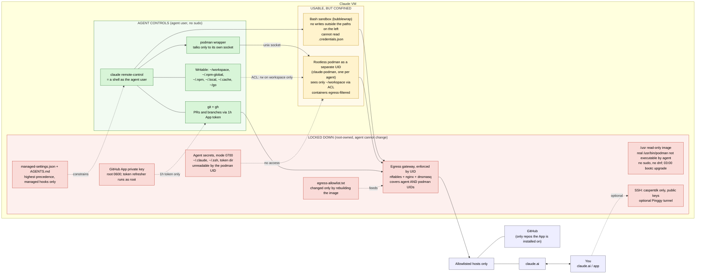

# Hard boundary: keep agent secrets out of rootless podman (one podman user per agent)

## Why a wrapper or SELinux label is not a hard boundary
Podman runs as the agent's own UID. Anything the agent UID can read, a container it starts can read
(`--security-opt label=disable`, `:Z`/`:z` relabel, `--privileged`, `--userns=keep-id`, or just calling `/usr/bin/podman`
directly). Software filters in front of podman can be bypassed; a custom SELinux type would need the agent's own domain
(`unconfined_service_t`) confined first. The only boundary the kernel enforces without that is **a different UID**.

## Decision: one podman user per agent user
Each agent user gets its own container identity, so nothing new is shared between agents (README: "nothing is shared
except the egress gateway"). A shared podman user would need write ACLs on both workspaces and become a bridge from the
weaker agent (`claude-rc-personal`) to the stronger one (`claude`: signing key, main GitHub App).

| Agent user | Podman user | Socket |
|---|---|---|
| `claude` (1100) | `claude-podman` | `/run/claude-vm/podman/claude/podman.sock` |
| `claude-rc-personal` (1101) | `claude-rc-personal-podman` | `/run/claude-vm/podman/claude-rc-personal/podman.sock` |

Naming rule: `<agent>-podman`. Created by sysusers/tmpfiles, same pattern as the agent users.

## Components (templated on `<agent>`, like `claude-vm-github-token@<user>`)
- `claude-vm-podman@<agent>.service` + `.socket`: runs `<agent>-podman`'s rootless `podman system service` on the socket.
  Socket is `0660 <agent>-podman:<agent>` so only that agent can use it. Per-unit `MemoryMax`/`CPUQuota`
  (also closes the cgroup-escape note). Inert until the agent user's own service is enabled, like the personal agent today.
- The agent's `podman` / `podman-compose` become root-owned wrappers in `/usr/libexec/claude-vm/bin` (first on PATH) that
  point at the calling user's socket: `podman --remote --url unix:///run/claude-vm/podman/<user>/podman.sock "$@"`.
- Real `/usr/bin/podman` is `chmod 0750 root:claude-podman-exec` (group of the `*-podman` users only), so the agent users
  cannot exec it. Remove the agent users from `/etc/subuid` and `/etc/subgid` so they cannot start their own user namespace
  with another binary. Each `*-podman` user gets its own non-overlapping ranges.
- Secrets stay `0700 <agent>` (`~/.claude`, `~/.ssh`, token dir, `/etc/claude-vm`). `<agent>-podman` has no access, so no mount
  flag can expose them: DAC is enforced by the kernel whatever the container flags are.
- Workspace (read + write): ACLs on `~/workspace` only, per agent:
  `setfacl -R -m u:<agent>-podman:rwX` and `setfacl -R -d -m u:<agent>-podman:rwX` (default ACL for new clones), and
  `setfacl -m u:<agent>-podman:--x` on the home directory so the path resolves but nothing else is listable.
  Applied by a tmpfiles/`ExecStartPre` step so it survives upgrades. The agent keeps ownership.
- Write ownership: containers run with `--userns=keep-id` by default (set via the wrapper's `containers.conf` in the
  `*-podman` user's config), so files written into the workspace are owned by the podman UID but readable/writable by the agent
  through the mirrored default ACL (`u:<agent>:rwX`, set on the same tree). Confirm in testing that git does not flag
  "dubious ownership"; if it does, add `safe.directory` for `~/workspace/*` in `/etc/gitconfig`.
- Egress: add each `<agent>-podman` UID and its subuid range to the nftables UID set so containers stay behind the gateway.
  Without this containers would be unrestricted.

## Behaviour changes to document (AGENTS.md, README)
- `podman` talks to a per-agent daemon; images and containers live under `<agent>-podman`, not `~/.local/share/containers`.
- Mount repos with `podman run -v ~/workspace/<repo>:/src ...` (no `:Z` needed; SELinux labels are handled for the podman user).
- Update the README diagram: podman moves into a "confined, separate UID" box fed by a socket; add the wrapper.
- Disk: image pulls are no longer shared between agents; note in sizing.

## Residual risks (state plainly in the README)
- Containers can read and write everything under that agent's `~/workspace` and anything world-readable on the VM.
- Shared kernel: a container escape lands as `<agent>-podman`, not as the agent or root.
- Anyone who can use the socket creates containers as `<agent>-podman`; the socket is limited to the owning agent.

## Tests (QEMU, `tests/claude-vm/`, run for each enabled agent)
1. `podman run -v ~/.claude:/x ... cat /x/.credentials.json` -> fails.
2. Same with `:Z`, `--security-opt label=disable`, `--privileged`, `--userns=host` -> fails.
3. Symlink `~/workspace/x -> ~/.claude`, mount it -> fails.
4. `podman run -v ~/workspace/repo:/src` can read a cloned repo and write a file the agent can then edit and `git status`.
5. The agent cannot exec `/usr/bin/podman`, has no subuid range, and cannot open the other agent's socket.
6. `claude-rc-personal`'s container cannot read or write `claude`'s workspace.
7. Container egress to a non-allowlisted host is blocked (existing test, now through the new UIDs).

## Rollout (separate PRs)
1. Users, subuid ranges, templated socket/service, nftables UID set (container still reachable the old way).
2. ACLs, wrapper, remove direct podman access, docs and diagram.
3. Tests; flip to enforce once green in QEMU.

## Updated diagram

