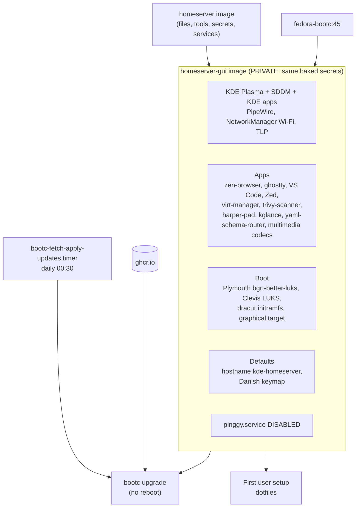

# homeserver-gui

`homeserver-gui.containerfile` builds `homeserver-gui-bootc`: the [home server](../homeserver/README.md) plus a KDE
Plasma desktop. Back to the [main README](../../README.md).

> **Private image**, for the same reason as the home server: it takes the same build secrets (age key, registry and
> pinggy tokens). See [homeserver](../homeserver/README.md#what-is-in-it).

## Overview

## How it differs

- **Files:** `system_files/homeserver/` and `system_files/homeserver-gui/` are both copied in, the GUI tree second.
- **Packages:** `system_files/homeserver-gui/usr/local/share/kde-bootc/packages-added` and `packages-removed`: Plasma,
  SDDM, KDE apps, fonts, zen-browser, ghostty, the libvirt/virt-manager stack, NetworkManager with Wi-Fi, PipeWire,
  TLP and Clevis for LUKS. Multimedia codecs come from the `multimedia` group with ffmpeg swapped in.
- **Extra software** (`build_files/gui/`): VS Code from Microsoft's repo, Zed, yaml-schema-router and the
  trivy-scanner (`cthtrifork/trivy-dashboard-wail3`), harper-pad (`cthtrifork/harper-pad`) and kglance (`cthtrifork/kglance`)
  RPMs. Versions use `# renovate:` comments. The trivy-scanner and harper-pad RPMs are PGP-signed and checked with
  their release key; the kglance RPM is not signed, so it is checked against the release's `SHA256SUMS`.
- **KGlance** is a popup with the clock, the date and the battery on `Meta+Alt+G` (change it in System Settings,
  Shortcuts). Its RPM adds an autostart entry (`kglance --background`), so the shortcut works after login.
- **Zed does not self-update.** The image pins Zed and the user-setup dotfiles sync restores that copy on every boot,
  so a self-update would be undone. `etc/environment.d/50-zed.conf` sets `ZED_UPDATE_EXPLANATION`, which is Zed's own
  switch for packaged installs: it stops update polling and makes "Check for Updates" show the message instead.
  Zed updates arrive with the image, via Renovate and `bootc upgrade`.
- **VS Code does not self-update and sends no telemetry.** It comes from Microsoft's repo at build time, so updates also
  arrive with the image. The dotfiles sync restores `~/.config/Code/User/settings.json` (`update.mode: none`,
  `extensions.autoUpdate` and `extensions.autoCheckUpdates` off, `telemetry.telemetryLevel: off`) and
  `~/.vscode/argv.json` (`enable-crash-reporter: false`) on every boot, so a change made in the editor is undone.
- **Defaults:** Danish console keymap, hostname `kde-homeserver`, VS Code extensions installed after boot by `bootc-vscode-extensions@caspertdk` (a timer starts it 30 s after boot and it waits for the network), and
  the graphical target is the default.
- **Boot:** Plymouth theme `bgrt-better-luks`, kernel args `quiet rhgb`, initramfs rebuilt with dracut.
- **No pinggy tunnel:** `build_files/gui/21-systemd.sh` disables `pinggy.service`.
- **Updates:** `bootc-fetch-apply-updates.timer` runs daily at 00:30 and `bootc upgrade` does not reboot, because
  this is a client machine. Drop-ins are in `usr/lib/systemd/system/bootc-fetch-apply-updates.*.d/`.

## CI

Builds and E2E run on the `arc-ubuntu` runner because of disk size, and rechunking (chunkah) uses the same 128 layers.
Local builds work as in [homeserver](../homeserver/README.md#local-build-test) with `-f homeserver-gui.containerfile`.

## Tests

`tests/homeserver-gui/system-test.sh` and `user-test.sh`, run in QEMU when a pull request has the `e2e` label, plus
the shared `tests/diagnostics.sh`.
