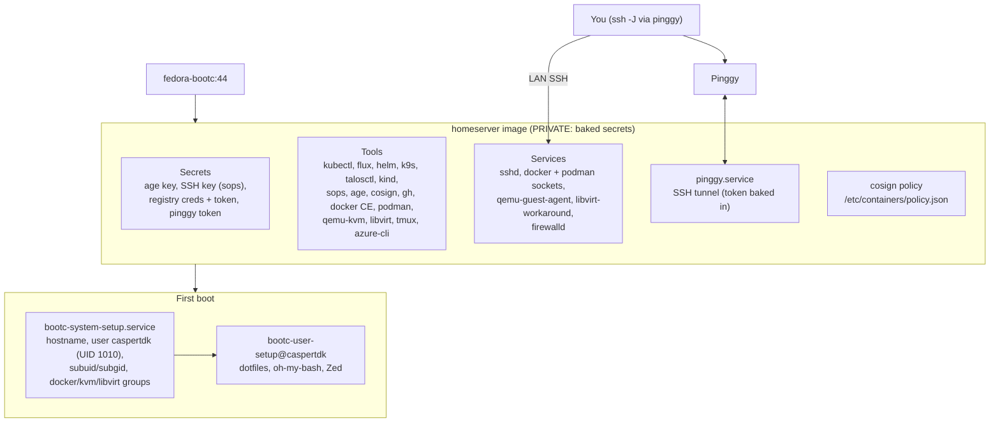

# homeserver

`homeserver.containerfile` builds `homeserver-centos-bootc`, the home server image. Back to the [main README](../../README.md).

> **Private image.** The build bakes secrets in: the age key (`/usr/lib/sops/age/keys.txt`), the SSH key decrypted
> from sops (`/usr/share/secrets/ssh/id_ed25519`), registry credentials (`/usr/lib/container-auth.json`), a registry
> token (`/etc/profile.d/62-registry-auth-private.sh`) and the pinggy token (`/etc/homeserver/metadata/pinggy`).
> Keep the package private. The [claude-vm](../claude-vm/README.md) image is the one built without secrets.

## Overview



## What is in it

- **Packages:** `system_files/homeserver/usr/local/share/bootc/packages-added` and `packages-removed` (tmux, direnv,
  fzf, bat, podman-compose, azure-cli, qemu-kvm, firewalld and so on).
- **Static tools** installed by `build_files/core/09-utilities.sh` (versions pinned with `# renovate:` comments): age,
  sops, gh, kubectl and plugins, kind, flux, kustomize, helm, k9s, talosctl, omnictl, mkcert, jq, yq, cosign, copa,
  shfmt, lazygit, lazydocker, lazyjournal and a few more. Docker CE comes from `10-server-docker-ce.sh`.
- **Services:** sshd, docker and podman sockets, qemu-guest-agent, `pinggy.service` (SSH tunnel, see below),
  `libvirt-workaround.service` (relabels libvirt paths) and the two setup units below.
- **Basics:** timezone Europe/Copenhagen, passwordless sudo for `wheel`, cosign policy in `/etc/containers/policy.json`.

## First boot

`bootc-system-setup.service` runs the hooks in `/usr/share/bootc/system-setup.hooks.d/`: hostname, the user `caspertdk`
(UID 1010, initial password set by `10-initial-password.sh`, so change it), subuid/subgid for rootless podman and the
docker, kvm and libvirt groups. `bootc-user-setup@caspertdk.service` then runs `user-setup.hooks.d/` (dotfiles from
`/usr/share/dotfiles`, oh-my-bash, Zed). Some hooks keep a version variable (for example `ROOTLESS_SETUP_VER`); bump it to make that hook run again.

## Remote access

```sh
# ~/.ssh/config
Host portableinfo.pinggy
  HostName portableinfo.a.pinggy.link
  User cthtrifork
  Port 21412
  SetEnv TERM=xterm-256color
```

```sh
ssh -J portableinfo.pinggy cthtrifork@192.168.1.136
```

## Secrets (sops + age)

```sh
sops --encrypt --age "$AGE_PUB" plain > encrypted.sops
SOPS_AGE_KEY_FILE=/var/lib/sops/age/keys.txt sops -d encrypted.sops > plain
```

## Local build test

The build needs the same secrets CI passes (registry, pinggy, creds, age key). Swap the containerfile to build the
other image.

```sh
echo "" > /tmp/PINGGY_TOKEN
echo "${GITHUB_TOKEN}" > /tmp/REGISTRY_TOKEN
cp "${HOME}/.docker/config.json" /tmp/creds
echo "${SOPS_AGE_KEY}" > /tmp/AGE_KEY
mkdir -p /tmp/runner/.cache/dnf /tmp/runner/.cache/tmp

podman build \
  --network=slirp4netns:enable_ipv6=false \
  -f homeserver.containerfile \
  --build-arg REGISTRY_USERNAME="caspertdk" \
  --build-arg REGISTRY_URL=ghcr.io \
  --build-arg PINGGY_HOST="test.com" \
  --build-arg REPOSITORY="https://github.com/cthtrifork/homeserver-bootc" \
  --secret id=registry_token,src=/tmp/REGISTRY_TOKEN \
  --secret id=pinggy_token,src=/tmp/PINGGY_TOKEN \
  --secret id=creds,src=/tmp/creds \
  --secret id=agekey,src=/tmp/AGE_KEY \
  -v /tmp/runner/.cache/dnf:/var/cache/libdnf5:z \
  -v /tmp/runner/.cache/tmp:/runner/cache:z
```

## Tests

`tests/homeserver/system-test.sh` and `user-test.sh`, run in QEMU when a pull request has the `e2e` label. The shared
`tests/diagnostics.sh` runs for every image, and `tests/verify-cosign.sh` for the home server images.
